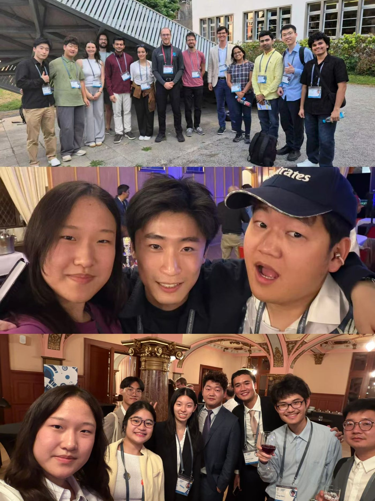
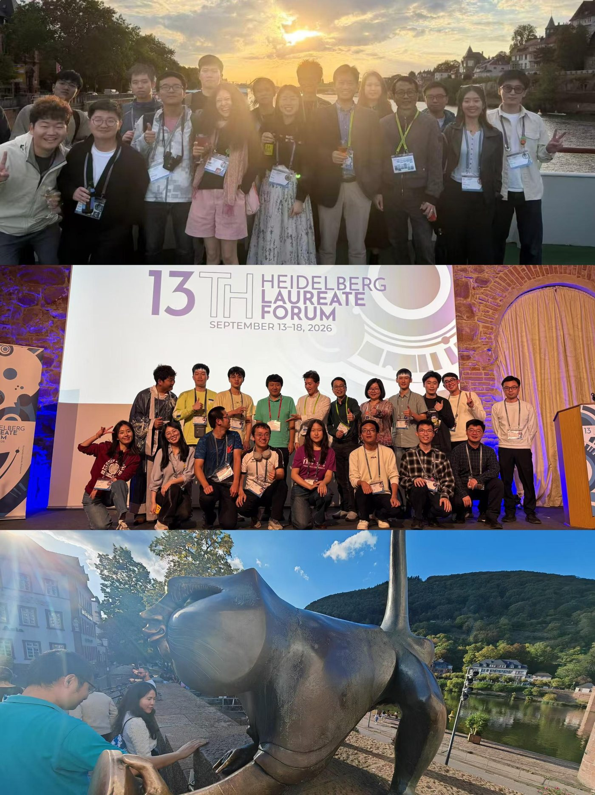

海德堡学者论坛是我参加过最好的一场学术活动，没有之一。海德堡又是这样一个具有德国古典小镇风格的学术圣地（还躲过了二战的炮火），以至于我都不舍得在小红书上分享，怕知道的人太多，明年会有 2 万个人申请，到时候录取率不到百分之一就不好玩了。只好在朋友圈里跟大家分享、安利一下。

海德堡学者论坛是一个面向数学和计算机青年学者的交流论坛。每年大概会有 200 位青年学者参加，包括本科生、研究生、博士后以及青年科学家，一半来自计算机，一半来自数学。大家做的方向都非常 diverse，做 AI 的人并没有那么多，让我感叹数学、计算机学者里居然也是有人不做 AI 的，哈哈（可能是因为自己陷入 AI 的浓度太高了）。

当然，今年的会议上也屡屡提起 AI，因为大家对 AI 还是有很强的危机意识。也有一些学者加入了 AI 的征途中（如今年的菲尔兹奖获得者 Jacob，他就加入了 OpenAI，并且成立了 Maisi），也有一些还在顽强抵抗。

现场有 20 多位菲尔兹奖、诺贝尔奖、图灵奖、阿贝尔奖、ACM 计算奖的获得者，也算是见到了那些曾经只存在于书本里的人物，计算机和数学界的先驱、祖师爷。在这里，你可以和他们促膝长谈，也可以在不同的活动上和他们打招呼、合影。我觉得和他们聊天时，最明显的感受就是：他们也是一个个活生生的人，没有任何架子，也给了我很多哲学上的思考（因为数学理论我听不懂）。

当然，我觉得最开心的还是和一群青年人一起 social、一起唱歌跳舞、一起 happy。虽然在科研时间大家可能都是 nerd，但是一到 party 时间，又纷纷迸发出了第二人格，高能量、高光环，非常尽兴地玩耍。

学者们来自 60 多个不同的国家，非常像一个地球村。主办方 HLFF 也非常细致地安排了全部行程，在学术和社交上做到了很好的平衡，也带我们打卡了海德堡的景点、城堡、庄园，以及各式各样好吃的。从某种程度上来说，这也是我一直在寻找的世外桃源。

关于寻找“世外桃源”的想法，是 2020 年我在 KAUST 参加学术海报比赛时萌生的。口语拙劣的我，第一次感受到这样一种氛围：像一个地球村，大家可以谈天说地，对无穷的远方和无数的人感兴趣。进可学技术，退可聊二次元、rap。再到后来，DBA 让这种 social 达到了顶峰，之后又急转直下，直至戛然而止；后来，我又逐渐变成了一个科研 i 人。

会有人问，参加这种活动有什么意义？

什么是意义呢？

暂停学校里的科研一周，去另一个陌生的国度当一个“社交恐怖分子”，结识一群不同的人，进入不同的身份，仿佛把人生多活了一遍。

桃花源的存在本身，就是意义吧。

哦对了，以上的一切都是有 HLFF 资助的。我也获得了 Abbe Grant issued by the Carl-Zeiss-Stiftung。当然，这些都是最微不足道的。如果有机会、有时间，我还会再来的！
